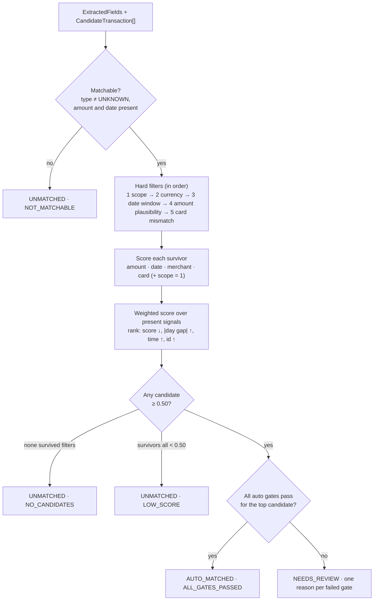
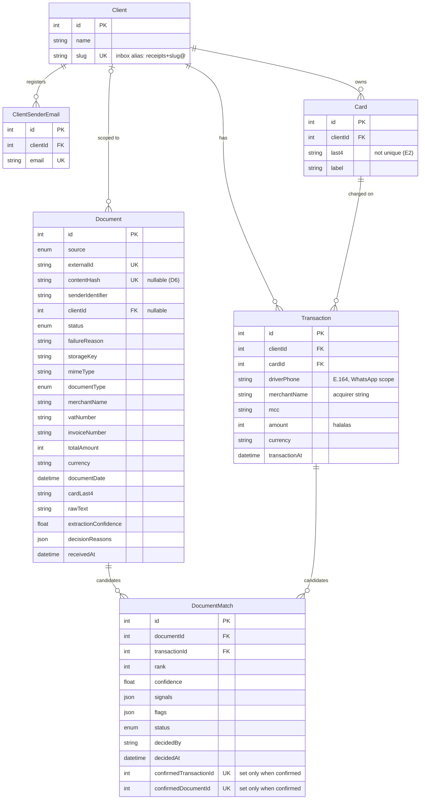
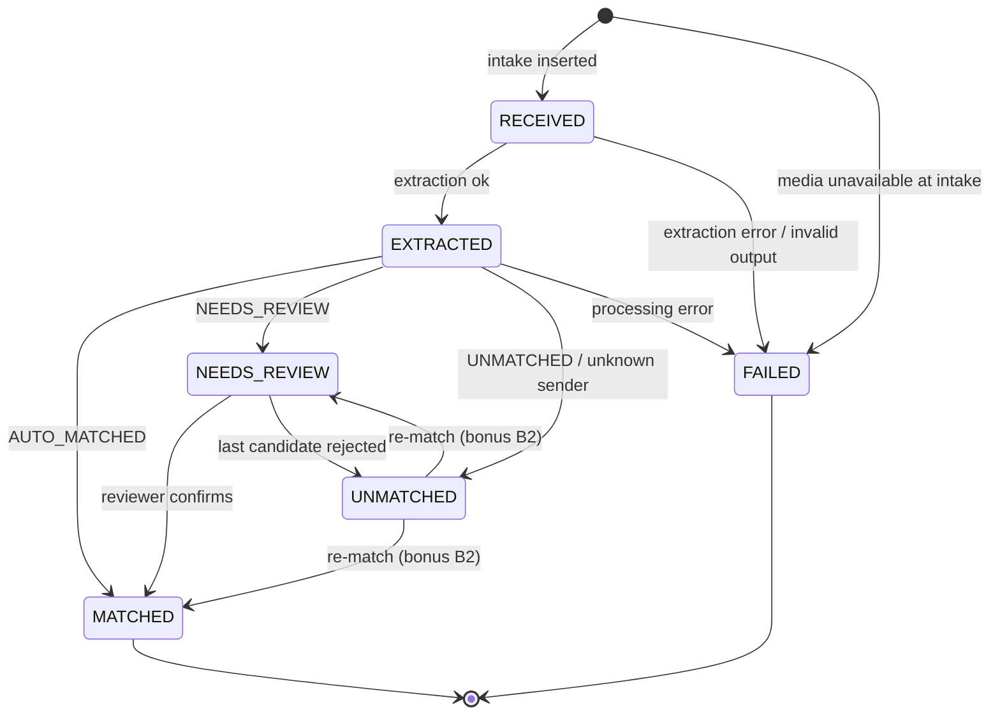
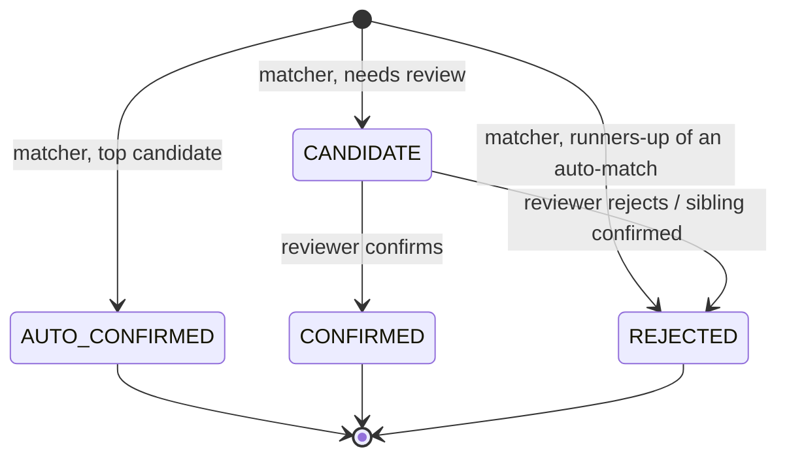

# Implementation Notes

How the receipt & invoice matching workflow is designed, **why** each decision was made over its alternatives, and
what I would do with more time.

- Architecture, folder map, interfaces and flow diagrams → [`docs/ARCHITECTURE.md`](docs/ARCHITECTURE.md)
- Every test scenario with its data and expected outcome → [`docs/SCENARIOS.md`](docs/SCENARIOS.md)

## Contents

1. [The problem, in one paragraph](#1-the-problem-in-one-paragraph)
2. [Guiding principle: precision over recall](#2-guiding-principle-precision-over-recall)
3. [Matching engine](#3-matching-engine)
4. [Merchant name normalization and similarity](#4-merchant-name-normalization-and-similarity)
5. [Ingestion and idempotency](#5-ingestion-and-idempotency)
6. [Data model](#6-data-model)
7. [Review actions](#7-review-actions)
8. [Decision log](#8-decision-log)
9. [Assumptions](#9-assumptions)
10. [Requirement traceability](#10-requirement-traceability)
11. [Risk register](#11-risk-register)
12. [With more time](#12-with-more-time)

---

## 1. The problem, in one paragraph

Every card purchase exists twice: once as the **card network's record** (noisy acquirer merchant name, charged amount
including tip, UTC timestamp, full card identity) and once as the **document** the driver or supplier sends (real
merchant name, pre-tip total, local date, maybe the last 4 card digits). There is no shared key, so matching is
**probabilistic record linkage**. Documents arrive through unreliable channels (redeliveries, resends, late arrivals,
unreadable photos), so the pipeline must never lose or duplicate one.

## 2. Guiding principle: precision over recall

The two possible errors do not cost the same:

| Error                                  | What happens                                                           | Cost                    |
| -------------------------------------- | ---------------------------------------------------------------------- | ----------------------- |
| **False positive** — wrong auto-attach | Nobody looks again; a VAT claim rests on wrong evidence until an audit | High, silent, delayed   |
| **False negative** — sent to review    | A reviewer spends ~30 seconds                                          | Low, visible, immediate |

So the system **automates only what it is sure about and routes the grey zone to people, with reasons.** Every
threshold and gate below follows from this.

---

## 3. Matching engine

`matchDocument(doc, transactions)` in `lib/services/transaction-matcher.ts` is a **pure function**: no I/O, no clock,
no randomness. Same input → same output, which is what makes it exhaustively testable.

### 3.1 Inputs and outputs

```ts
interface ExtractedFields {
  documentType: 'RECEIPT' | 'TAX_INVOICE' | 'UNKNOWN';
  merchantName: string | null;
  totalAmount: number | null; // halalas
  currency: string | null;
  documentDate: string | null; // ISO 8601, may be date-only
  cardLast4: string | null;
  extractionConfidence: number; // 0..1
  scope: SenderScope; // who sent it → which transactions it may match
}

interface SenderScope {
  clientIds: number[];
  driverPhone: string | null; // set for WhatsApp: only this driver's transactions
}

interface CandidateTransaction {
  id: number;
  clientId: number;
  driverPhone: string | null;
  cardLast4: string;
  merchantName: string;
  mcc: string;
  amount: number;
  currency: string;
  transactionAt: Date;
  hasConfirmedDocument: boolean;
}

interface MatchCandidate {
  transactionId: number;
  confidence: number; // 0..1
  signals: Record<string, number>; // only signals that were measurable (see 3.4)
  flags: CandidateFlag[]; // e.g. AMOUNT_TIP_TOLERANCE, CARD_POSSIBLE_MISREAD
}

interface MatchResult {
  outcome: 'AUTO_MATCHED' | 'NEEDS_REVIEW' | 'UNMATCHED';
  candidates: MatchCandidate[]; // ranked, best first, only those >= review threshold
  reasons: ReasonCode[]; // why this outcome
  excluded: Record<FilterName, number>; // how many transactions each hard filter removed
}
```

The spec's `MatchCandidate`/`MatchResult` shapes are kept and **extended** (`flags`, `reasons`, `excluded`) — the spec
says "design your own scoring", and explainability is graded.

### 3.2 Pipeline



The design separates three questions that a plain weighted sum mixes up:

1. **Filters** — _could this transaction possibly be the one?_ (binary, removes candidates)
2. **Score** — _how similar is it?_ (0..1, ranks candidates, explains itself via `signals`)
3. **Gates** — _is it safe to act without a human?_ (decides the outcome)

### 3.3 Hard filters

A transaction failing any filter is removed and counted in `excluded`.

| #   | Filter          | Removes a transaction when…                                                   | Why it is a filter, not a score                                                     |
| --- | --------------- | ----------------------------------------------------------------------------- | ----------------------------------------------------------------------------------- |
| 1   | **Scope**       | `clientId ∉ scope.clientIds`, or (WhatsApp) `driverPhone ≠ scope.driverPhone` | Matching across clients is a data leak, not a "low score"                           |
| 2   | **Currency**    | Both currencies known and different                                           | E4: settled SAR amounts; a 150 AED receipt is not comparable to 153 SAR             |
| 3   | **Date window** | `d = docDay − txnDay` outside **−3…+1** (receipt) or **−1…+30** (tax invoice) | Bounds the search; invoices are legitimately issued days/weeks after the purchase   |
| 4   | **Amount**      | Amount class is `NONE` (see 3.4)                                              | In a fleet, merchant/card/date repeat constantly — amount is the main discriminator |
| 5   | **Card**        | Both last4 present and **≥ 2 digits** differ                                  | One differing digit is a plausible OCR misread; two is a different card             |

Days are **Riyadh calendar days** (UTC+3). A purchase at 01:30 Riyadh time is the previous day in UTC (see T04 in the
scenarios). Date-only strings (`"2025-06-14"`) are read as Riyadh dates, never as UTC midnight.

### 3.4 Signals

Each signal is a `SignalScorer` (Strategy pattern, one file each). A signal that cannot be measured — the receipt has
no merchant name or no card digits — is **omitted** from `signals` and from the weighting, never scored as 0:
penalizing a receipt for not printing card digits would be wrong.

| Signal       | Value                                                                                                                     | Weight |
| ------------ | ------------------------------------------------------------------------------------------------------------------------- | -----: |
| **amount**   | `EXACT` (\|diff\| ≤ 5 halalas) → **1.0** · `TIP` → **0.7** + flag · `NEAR` (\|diff\| ≤ 1 %) → **0.5** · `NONE` → filtered |   0.40 |
| **date**     | \|d\| = 0 → **1.0** · 1 → **0.8** · 2 → **0.6** · 3 → **0.4** · 4–7 → **0.2** · 8+ → **0.1** (invoices only)              |   0.20 |
| **merchant** | Similarity of normalized names, 0..1 (section 4)                                                                          |   0.20 |
| **card**     | Equal → **1.0** · one digit differs → **0.3** + flag `CARD_POSSIBLE_MISREAD`                                              |   0.20 |
| **scope**    | Always **1** for survivors — recorded so the breakdown shows it was checked                                               |      0 |

`TIP` = the card was charged **more** than the receipt, by at most **20 %**, at a restaurant (MCC **5812/5814**).
Tips are directional (the charge never goes _down_) and only exist where people tip; a fuel station charging 10 %
more than its receipt is a different purchase (scenario U05).

**Why these weights.** Amount carries 40 % because it is the only field that both sides record precisely and that
varies between a driver's purchases. Date, merchant and card are each weaker on their own — a fleet driver refuels at
the same station with the same card several times a week — so they share the rest equally rather than pretending to
a precision we have no data for. Scope has weight 0 because it is a filter: every survivor has it.

### 3.5 Decision gates

The top-ranked candidate is **auto-matched only if every gate passes**. Each failed gate adds its reason code.

| Gate                                  | Threshold                             | Reason if it fails                          | Why                                                                                                               |
| ------------------------------------- | ------------------------------------- | ------------------------------------------- | ----------------------------------------------------------------------------------------------------------------- |
| Score high enough                     | ≥ **0.85**                            | `BELOW_AUTO_THRESHOLD`                      | Exact amount + same-ish day + one strong identity signal clears it; a 3-day gap with no card does not (U03)       |
| Amount is exact                       | amount = 1.0                          | `AMOUNT_TIP_TOLERANCE` / `AMOUNT_NOT_EXACT` | VAT evidence must show the charged amount; a tip is plausible, not proven                                         |
| Identity corroborated                 | card = 1.0 **or** merchant ≥ **0.80** | `WEAK_IDENTITY`                             | Amount + date alone renormalize to a high score from thin evidence (U02)                                          |
| Clear winner                          | top − second ≥ **0.10**               | `NEAR_TIE`                                  | One day of date difference moves a score by only 0.04–0.05; that must not decide alone (S12)                      |
| OCR is trustworthy                    | `extractionConfidence` ≥ **0.80**     | `LOW_OCR_CONFIDENCE`                        | The OCR's own doubt about its fields is a reason to ask a human (U01)                                             |
| Transaction has no confirmed document | `hasConfirmedDocument = false`        | `TXN_ALREADY_HAS_DOCUMENT`                  | Spec rule; also the second line of defence against **re-photographed** duplicates, which a byte hash cannot catch |
| No warning flags                      | `flags` empty                         | the flag itself                             | e.g. `CARD_POSSIBLE_MISREAD` keeps the candidate but needs eyes (S09)                                             |

Candidates are kept (and persisted) only if they score ≥ **0.50** — below that, showing them to a reviewer wastes
time. At most **5** are stored. Everything lives in `matching-config.ts`, one typed object.

### 3.6 Reason codes

| Outcome        | Reason codes                                                                                                                                                               |
| -------------- | -------------------------------------------------------------------------------------------------------------------------------------------------------------------------- |
| `AUTO_MATCHED` | `ALL_GATES_PASSED`                                                                                                                                                         |
| `NEEDS_REVIEW` | `BELOW_AUTO_THRESHOLD`, `AMOUNT_TIP_TOLERANCE`, `AMOUNT_NOT_EXACT`, `WEAK_IDENTITY`, `NEAR_TIE`, `LOW_OCR_CONFIDENCE`, `TXN_ALREADY_HAS_DOCUMENT`, `CARD_POSSIBLE_MISREAD` |
| `UNMATCHED`    | `NOT_MATCHABLE`, `NO_CANDIDATES`, `LOW_SCORE` — plus `UNKNOWN_SENDER`, set by the processor before the matcher runs                                                        |

### 3.7 Worked examples

All scenarios, with their full arithmetic, are in [`docs/SCENARIOS.md`](docs/SCENARIOS.md#3-end-to-end-scenarios-fixtures--seed).
The spec's six edge cases:

| Spec edge case                       | Scenario | Top score | Outcome                                      |
| ------------------------------------ | -------- | --------: | -------------------------------------------- |
| 1. Exact match                       | S01      |      1.00 | `AUTO_MATCHED` (runner-up 0.88, margin 0.12) |
| 2. Same amount, same day, same chain | S02      |      1.00 | `NEEDS_REVIEW` · `NEAR_TIE`                  |
| 3. Tip (57.50 vs 63.25)              | S03      |      0.88 | `NEEDS_REVIEW` · `AMOUNT_TIP_TOLERANCE`      |
| 4. Same photo twice                  | S04      |         — | No new document (`contentHash`)              |
| 5. Transaction doesn't exist yet     | S05      |         — | `UNMATCHED` · `NO_CANDIDATES`                |
| 6. Garbage extraction                | S06      |         — | `UNMATCHED` · `NOT_MATCHABLE`, no crash      |

S03 shows why gates exist: on score alone (0.88 ≥ 0.85) the tip would auto-match.

### 3.8 These are scores, not probabilities

There is no labelled data, so 0.85 is a **reasoned threshold, not a measured one**. Each value above is justified by
walking the scenario matrix, not by fitting. The honest path to calibration is already built into the data model:
every persisted candidate stores its `signals`, and every reviewer confirm/reject is a label. With a few thousand
decisions, a logistic regression over `signals` gives learned weights and a probability-calibrated auto threshold.

**Alternatives considered:**

| Approach                                   | Why not (now)                                                                                                                                                                      |
| ------------------------------------------ | ---------------------------------------------------------------------------------------------------------------------------------------------------------------------------------- |
| Plain weighted sum + one threshold         | Lets strong merchant/date compensate for a wrong amount, inflates thin evidence, averages away contradictions                                                                      |
| Fellegi–Sunter (log-likelihood per signal) | The principled record-linkage model, but its m/u probabilities would be guessed without data, and it is harder to explain to a reviewer. The right next step **once** labels exist |
| ML model                                   | No training data; not explainable to auditors on day one                                                                                                                           |

---

## 4. Merchant name normalization and similarity

Acquirer strings are abbreviated and noisy (`ALFANAR FUEL ST 04 RUH`); receipts print the trading name
(`Alfanar Fuel Station`). Two swappable pieces handle this, each behind an interface.

**`MerchantNormalizer`** turns a name into a token list:

1. Unicode-normalize, strip diacritics, lowercase; `&` → `and`; drop apostrophes (`McDonald's` → `mcdonalds`).
2. Non-alphanumerics → space; split into tokens.
3. Drop tokens containing digits (`04`, `#1234`), store markers (`st`, `stn`, `station`, `br`, `branch`, `no`),
   legal suffixes (`co`, `company`, `llc`, `ltd`, `est`, `trading`), articles (`al`, `the`, `and`), and city codes
   (`ruh`, `jed`, `dmm`, `mak`, `med`, `khb`, `riyadh`, `jeddah`, `dammam`, …).
4. Expand a small abbreviation map (`svc` → `service`).

`ALFANAR FUEL ST 04 RUH` → `[alfanar, fuel]` and `Alfanar Fuel Station` → `[alfanar, fuel]`.

**`StringSimilarity`** (default: weighted token Dice with Jaro–Winkler):

- Tokens are paired one-to-one, greedily by highest Jaro–Winkler; a pair counts if JW ≥ 0.88 (absorbs typos and
  abbreviations like `alfnr`).
- **Generic category words** (`fuel`, `petrol`, `gas`, `grill`, `restaurant`, `cafe`, `car`, `wash`, `auto`,
  `service`, `market`, …) weigh **0.3**; distinctive words weigh **1.0** — so `rawabi fuel` vs `alfanar fuel` shares
  only `fuel` and scores **0.23**, not 0.5.
- `score = 2 · Σ(pair weight × JW) / (Σ weights A + Σ weights B)` ∈ [0, 1].

**Trade-off — store numbers are discarded.** It makes `ST 04` vs `Station 04` match, but it also means station 04 and
station 11 look identical (scenario S02 → review). Keeping numbers would separate them only when the receipt prints the
station number _and_ OCR reads it correctly; a wrong guess there would cause a confident wrong match, which section 2
says is the worse error.

**Known limitation:** an Arabic receipt (`الفنار`) against a Latin acquirer name scores 0. Transliteration is listed in
[With more time](#12-with-more-time); the result today is a review or unmatched, never a wrong auto-match.

**Alternatives considered:** plain Levenshtein on the whole string (punished by word order and extra tokens);
trigram similarity (good, but weaker on short brand names); a merchant master table keyed by VAT number (best signal,
but needs data we don't have — listed under more time).

---

## 5. Ingestion and idempotency

Flow diagrams: [`docs/ARCHITECTURE.md` § Flows](docs/ARCHITECTURE.md#5-flows).

### 5.1 Idempotency keys

| Key           | Value                                                  | Catches                                                   |
| ------------- | ------------------------------------------------------ | --------------------------------------------------------- |
| `externalId`  | Email: `messageId:attachmentIndex` · WhatsApp: `wamid` | Provider **redelivery** of the same message               |
| `contentHash` | SHA-256 of the file bytes (computed by us)             | The **same file** resent under a new message, any channel |

Both are `UNIQUE` columns. Intake is **insert-first**: it tries to insert and treats a unique-constraint violation
(Prisma `P2002`) as "duplicate". A check-then-insert would let two concurrent redeliveries both pass the check.

The WhatsApp payload's own `sha256` is **not** trusted as the key — we hash the bytes we actually fetched.

### 5.2 When things happen

| Step                                                | Where                       | Why there                                                             |
| --------------------------------------------------- | --------------------------- | --------------------------------------------------------------------- |
| Validate payload (Zod), adapt to `InboundMessage[]` | Request (sync)              | Bad input must get a `400` immediately                                |
| Resolve sender → scope                              | Request (sync)              | Cheap lookup; stored on the document                                  |
| Fetch WhatsApp media, hash bytes                    | Request (sync, 3 s timeout) | The hash is the dedupe key and must exist **before** the insert (D17) |
| Insert `Document` (`RECEIVED`)                      | Request (sync)              | Once this commits, the document can never be lost                     |
| Respond                                             | Request                     | `200` with a per-message result                                       |
| Extract → match → persist                           | `after()` (post-response)   | Slow and failure-prone; must never delay or fail the webhook          |

### 5.3 HTTP contract

| Situation                                                    | Status | Body                                                                                         |
| ------------------------------------------------------------ | ------ | -------------------------------------------------------------------------------------------- |
| Accepted (any mix of created / duplicate / ignored messages) | 200    | `{ results: [{ externalId, result: 'created' \| 'duplicate' \| 'ignored', documentId? }] }`  |
| Malformed envelope                                           | 400    | `{ error: 'INVALID_PAYLOAD', issues: [{ path, message }] }`                                  |
| Could not persist (e.g. database down)                       | 500    | `{ error: 'INTERNAL' }` — nothing was saved, so the provider's retry is exactly what we want |

"Never 500 because extraction or matching failed" holds by construction: those run after the response. A `500` is
only possible **before** anything is persisted, which is the one case where a retry is correct.

### 5.4 Failure mapping

| Failure                                             | Document ends as | `failureReason` / reason |
| --------------------------------------------------- | ---------------- | ------------------------ |
| WhatsApp media id unknown or fetch timed out        | `FAILED`         | `MEDIA_UNAVAILABLE`      |
| Extractor throws                                    | `FAILED`         | `EXTRACTION_ERROR`       |
| Extractor output fails Zod validation               | `FAILED`         | `EXTRACTION_INVALID`     |
| Unexpected error while matching or persisting       | `FAILED`         | `PROCESSING_ERROR`       |
| Extracted, but `UNKNOWN` type / no amount / no date | `UNMATCHED`      | `NOT_MATCHABLE`          |
| Sender maps to no client                            | `UNMATCHED`      | `UNKNOWN_SENDER`         |

---

## 6. Data model

### 6.1 Entities



Changes from the spec's suggested schema, and why:

| Change                                                                                                                     | Why                                                                                        |
| -------------------------------------------------------------------------------------------------------------------------- | ------------------------------------------------------------------------------------------ |
| `Client`, `ClientSenderEmail`                                                                                              | Email scoping needs a sender → client mapping (E1); the spec schema has none               |
| `Card` entity; `Transaction.cardLast4` → `cardId`                                                                          | Two cards can share a last4 (E2); a `Card` row makes that explicit instead of merging them |
| `Transaction.driverPhone` kept (not moved to `Card`)                                                                       | Fleet cards are often per vehicle and shared; the driver is a fact of the _transaction_    |
| `Transaction.mcc`                                                                                                          | Tip tolerance applies only to restaurants (D3)                                             |
| `Document.contentHash` nullable                                                                                            | A document whose media could not be fetched must still be saved as `FAILED` (D6)           |
| `Document.clientId`, `failureReason`, `decisionReasons`, `invoiceNumber`, `extractionConfidence`, `storageKey`, `mimeType` | Scope, explainability, audit, and letting a reviewer see the file (D10)                    |
| `DocumentMatch.rank`, `flags`, `confirmed*Id`                                                                              | Ordering, per-candidate warnings, and the one-confirmed rules (below)                      |
| `documentType` as an enum                                                                                                  | It is a closed set in the provided interface                                               |

### 6.2 Rules the database enforces

| Rule                                                                                       | Mechanism                                                                     |
| ------------------------------------------------------------------------------------------ | ----------------------------------------------------------------------------- |
| One `Document` per provider message                                                        | `UNIQUE(externalId)`                                                          |
| One `Document` per file content                                                            | `UNIQUE(contentHash)` (nullable: SQLite allows many `NULL`s)                  |
| A transaction appears once per document's candidate list                                   | `UNIQUE(documentId, transactionId)` (spec)                                    |
| **At most one confirmed document per transaction** (R25)                                   | `UNIQUE(confirmedTransactionId)` — set to `transactionId` only when confirmed |
| At most one confirmed transaction per document                                             | `UNIQUE(confirmedDocumentId)` — set to `documentId` only when confirmed       |
| `confirmed*Id` is set **if and only if** status is confirmed, and equals the row's own ids | `CHECK` constraints added to the migration SQL                                |

**Why nullable unique columns instead of a partial unique index** (`… WHERE status IN ('CONFIRMED','AUTO_CONFIRMED')`):
SQLite supports partial indexes, but Prisma's schema cannot express them, so `prisma migrate` would treat a
hand-written one as drift. Nullable unique columns are first-class in Prisma and give the same guarantee.

### 6.3 Document lifecycle



Every transition goes through `DocumentStateMachine`, which rejects anything not drawn here and writes with a
conditional update (`WHERE id = ? AND status = <expected from>`), so two concurrent workers cannot both advance a
document.

### 6.4 Match lifecycle



Undoing an `AUTO_CONFIRMED` match is out of scope (not asked for; listed under more time).

---

## 7. Review actions

`confirmMatch` and `rejectMatch` (`lib/actions/review.ts`) are thin next-safe-action wrappers over `ReviewService`.
They use `.inputSchema()` — the spec's `.schema()` is a deprecated alias in next-safe-action v8.

| Call                                                      | Result                                                                                                    |
| --------------------------------------------------------- | --------------------------------------------------------------------------------------------------------- |
| Confirm a `CANDIDATE`                                     | Match `CONFIRMED`, siblings `REJECTED`, document `MATCHED` — one transaction                              |
| Confirm the **same** match again (double-submit)          | No-op success (`alreadyConfirmed`)                                                                        |
| Confirm a sibling after one was confirmed                 | Error `MATCH_NOT_PENDING`                                                                                 |
| Confirm when the transaction already has a document (S07) | Error `TRANSACTION_ALREADY_HAS_DOCUMENT` — raised by `UNIQUE(confirmedTransactionId)`, not by a pre-check |
| Confirm a `REJECTED` match                                | Error `MATCH_NOT_PENDING`                                                                                 |
| Reject a `CANDIDATE`, others remain                       | Match `REJECTED`, document stays `NEEDS_REVIEW`                                                           |
| Reject the last remaining `CANDIDATE`                     | Match `REJECTED`, document `UNMATCHED`                                                                    |
| Reject the same match again                               | No-op success (`alreadyRejected`)                                                                         |
| Unknown `matchId` / invalid input                         | `MATCH_NOT_FOUND` / validation error                                                                      |

Double-submit safety comes from conditional updates (`UPDATE … WHERE id = ? AND status = 'CANDIDATE'`) inside one
database transaction, checking the affected row count — not from UI state. Reviewer identity is a placeholder
(`reviewer:demo`) because authentication is out of scope.

---

## 8. Decision log

Each decision lists what was chosen, what was rejected, and why.

### Confirmed with the examiner ("take your defaults")

| ID  | Decision                                                                            | Rejected alternative                  | Why                                                                                          |
| --- | ----------------------------------------------------------------------------------- | ------------------------------------- | -------------------------------------------------------------------------------------------- |
| E1  | Email scope: `to` alias `receipts+<slug>@` → registered `from` → `UNKNOWN_SENDER`   | `from` only                           | The spec's own example `from` is a supplier who serves many clients; an alias is unambiguous |
| E2  | Card last4 is not unique per client                                                 | Treat last4 as an identifier          | 10,000 values; ~40 % collision chance in a 100-card fleet                                    |
| E3  | Strictly one confirmed document per transaction; a later tax invoice goes to review | Let the invoice supersede the receipt | Spec rule as written; supersede listed under more time                                       |
| E4  | Transaction amounts are final settled values; refunds out of scope                  | Model pre-authorizations              | Exact-amount matching is meaningless against a pre-auth hold                                 |

### Design decisions

| ID  | Decision                                                                           | Rejected alternative                             | Why                                                                                                              |
| --- | ---------------------------------------------------------------------------------- | ------------------------------------------------ | ---------------------------------------------------------------------------------------------------------------- |
| D1  | Precision over recall                                                              | Maximize auto-match rate                         | Section 2: a wrong attach is silent and costly; a review is cheap                                                |
| D2  | Filters → weighted score → gates, with reason codes                                | Plain weighted sum; Fellegi–Sunter               | Section 3.8                                                                                                      |
| D3  | `mcc` on transactions; tip band only for MCC 5812/5814; tips never auto            | Global ±20 % tolerance                           | A fuel station charging 20 % over its receipt would look plausible                                               |
| D4  | Card last4 graded: equal / one-digit misread / filtered / absent                   | Hard veto on any mismatch                        | Thermal-paper OCR confuses `1`/`7`, `0`/`8`; a random different card differs in one digit only 0.4 % of the time |
| D5  | `Card` entity (`clientId`, `last4`, `label`); `driverPhone` stays on `Transaction` | Flat `cardLast4` string; `driverPhone` on `Card` | Makes shared last4 explicit; drivers share vehicle cards, so the driver belongs to the transaction               |
| D6  | `contentHash` nullable                                                             | Required hash                                    | A failed media fetch would otherwise lose the webhook                                                            |
| D7  | Malformed envelope → 400; a bad message inside a valid envelope is skipped, 200    | 400 for the whole batch                          | Meta retries the whole delivery on non-2xx — one bad message would loop forever                                  |
| D8  | Runners-up of an auto-match stored as `REJECTED` by `system`                       | Discard them                                     | Audit trail, and future training data                                                                            |
| D9  | Same confirm twice = no-op; confirming a sibling or rejected match = error         | Error on every repeat                            | Double-clicks are normal; conflicting decisions are not                                                          |
| D10 | `storageKey` + `mimeType` on `Document`                                            | Store bytes in the database                      | A reviewer must see the file; blobs belong in object storage                                                     |
| D11 | Scope filtered in the query **and** re-checked in the matcher (`signals.scope`)    | Query only                                       | Defence in depth; the spec lists scoping as a signal                                                             |
| D12 | Unmeasurable signals omitted from `signals`; `reasons`/`flags` added               | `null` values                                    | Keeps the spec's `Record<string, number>` type                                                                   |
| D13 | Persist → respond → `after()` for extraction + matching                            | Synchronous processing; a queue                  | Fast responses without infrastructure; a queue is the production path (risk register)                            |
| D14 | Extractor/media failures → `FAILED`; extracted-but-unusable → `UNMATCHED` + reason | Everything `FAILED`                              | `FAILED` means "system problem, retry"; `UNMATCHED` means "a human should look"                                  |
| D15 | Ingestion tests on a real SQLite test database                                     | Mocked Prisma                                    | Idempotency is a unique-constraint property; only a real database proves it                                      |
| D16 | No status-history table                                                            | `DocumentEvent` audit table                      | Final state + `decidedBy`/`decidedAt`/`failureReason` answer who/when/why; history under more time               |
| D17 | WhatsApp media fetched and hashed **during** the request (3 s timeout)             | Fetch in the background                          | Content dedupe must happen before the row exists; otherwise duplicates need a merge state                        |
| D18 | Amount plausibility is a **filter** (directional, MCC-aware)                       | Amount as a score only                           | Stops strong merchant/date/card from dragging a different purchase into review                                   |
| D19 | `MatchResult.excluded` counts per filter                                           | Only return survivors                            | Explains _why_ nothing matched ("4 removed by currency")                                                         |
| D20 | Generic category words weigh 0.3 in merchant similarity                            | All tokens equal                                 | `rawabi fuel` vs `alfanar fuel` must not score 0.5 just for sharing `fuel`                                       |
| D21 | Store numbers dropped during normalization                                         | Keep them                                        | Section 4 trade-off: avoids confident wrong matches from misread station numbers                                 |

---

## 9. Assumptions

- Reviewers are trusted internal users; authentication and authorization are out of scope (`reviewer:demo`).
- All transactions are SAR; documents in another currency never match (S13).
- Transactions arrive through an existing feed; this project seeds them (an ingestion entry point is bonus B2).
- Riyadh has no daylight saving time, so "Riyadh day" is a fixed UTC+3 offset.
- Provider timestamps (`receivedAt`, WhatsApp `timestamp`) are not used for matching. The spec's WhatsApp example
  timestamp `1718356881` is 2024-06-14 while its email example is 2025-06-14; we use the document's printed date.
- Attachments other than PDF/JPEG/PNG/WebP/HEIC, or smaller than 8 KB (signature logos), are ignored.
- File bytes are referenced by `storageKey`; in this project the store is the `fixtures/` directory.

---

## 10. Requirement traceability

Every requirement in the brief, the milestone that delivers it, and the test or check that proves it. The
"Verified by" column is filled in as each milestone closes.

| ID  | Requirement                                                                  | Milestone  | Verified by                                             |
| --- | ---------------------------------------------------------------------------- | ---------- | ------------------------------------------------------- |
| R1  | `POST /api/webhooks/email`                                                   | M4         | pending M4                                              |
| R2  | `POST /api/webhooks/whatsapp`                                                | M4         | pending M4                                              |
| R3  | `MediaStore` interface backed by a fixture map                               | M3         | pending M3                                              |
| R4  | Zod validation; malformed → 400 with a useful body                           | M4         | pending M4                                              |
| R5  | Same message id → no duplicate document                                      | M4         | pending M4                                              |
| R6  | Same file content → no duplicate document                                    | M4         | pending M4                                              |
| R7  | Fast response; never 500 on extraction/matching failure                      | M4         | pending M4                                              |
| R8  | Sender phone/email scope matchable transactions                              | M1, M2, M4 | pending                                                 |
| R9  | `ExtractedDocument` / `DocumentExtractor` interfaces                         | setup      | `lib/extraction/types.ts` (verbatim)                    |
| R10 | `MockExtractor` keyed by file hash                                           | M3         | pending M3                                              |
| R11 | ≥ 6 committed fixture documents                                              | M3         | pending M3                                              |
| R12 | Pipeline coded against the extractor interface                               | M3, M4     | pending                                                 |
| R13 | Prisma schema                                                                | M2         | pending M2                                              |
| R14 | Seed: ~15 transactions, 2 clients, sender mapping                            | M2         | pending M2                                              |
| R15 | Pure `matchDocument`, spec result shapes                                     | M1         | pending M1                                              |
| R16 | Amount, date, merchant, card, scope signals                                  | M1         | pending M1                                              |
| R17 | Weights and thresholds documented and justified                              | M0, M1     | this file, section 3                                    |
| R18 | High single candidate → `AUTO_MATCHED`, `AUTO_CONFIRMED`, document `MATCHED` | M1, M4     | pending                                                 |
| R19 | Mid confidence or near tie → `NEEDS_REVIEW`, ranked candidates persisted     | M1, M4     | pending                                                 |
| R20 | Nothing plausible → `UNMATCHED`                                              | M1, M4     | pending                                                 |
| R21 | Transaction with a confirmed document never auto-matches a second            | M1, M4     | pending                                                 |
| R22 | Edge cases 1–6 in fixtures and tests                                         | M1, M3, M4 | pending                                                 |
| R23 | `confirmMatch` semantics                                                     | M5         | pending M5                                              |
| R24 | `rejectMatch` semantics                                                      | M5         | pending M5                                              |
| R25 | Double-submit safe; one confirmed document per transaction in the data layer | M2, M5     | pending                                                 |
| R26 | Matcher unit tests for every edge case                                       | M1         | pending M1                                              |
| R27 | Ingestion tests: once, redelivery, extraction failure                        | M4         | pending M4                                              |
| R28 | Normalization/similarity tests on messy merchant strings                     | M1         | pending M1                                              |
| R29 | TypeScript strict, Zod at boundaries, no `any`                               | all        | `tsconfig.json` strict; ESLint `no-explicit-any: error` |
| R30 | README: setup, run, seed, fire webhooks, run tests                           | M6         | pending M6                                              |
| R31 | `IMPLEMENTATION.md`: approach, decisions, assumptions, more time, trade-offs | M0 → M6    | this file                                               |
| R32 | GitHub repository shared                                                     | M6         | pending M6                                              |
| R33 | Spec project structure and boilerplate                                       | setup      | files byte-identical to the brief                       |
| B1  | Bonus: `/review` page                                                        | M9         | pending                                                 |
| B2  | Bonus: re-match `UNMATCHED` documents when transactions arrive               | M8         | pending                                                 |
| B3  | Bonus: multi-transaction invoice design sketch                               | M7         | pending                                                 |
| B4  | Bonus: real extractor behind the interface, mock by default                  | M11        | optional                                                |
| B5  | Bonus: HMAC signature verification                                           | M10        | pending                                                 |

---

## 11. Risk register

| Risk                                                             | Impact                                        | Mitigation now                                                              | Production answer                              |
| ---------------------------------------------------------------- | --------------------------------------------- | --------------------------------------------------------------------------- | ---------------------------------------------- |
| `after()` work is lost if the process crashes                    | Document stuck in `RECEIVED`                  | State is visible; a `reprocess(documentId)` entry point is cheap to add     | Durable queue (SQS / BullMQ) with retries      |
| Hand-tuned weights and thresholds                                | Wrong auto-matches or too many reviews        | Conservative gates; every decision stores its `signals`                     | Calibrate on reviewer decisions (section 3.8)  |
| `CHECK` constraints live only in migration SQL                   | A future SQLite table rebuild could drop them | Unique columns already enforce the core rule; tests assert the checks exist | Postgres partial unique index + `CHECK`        |
| Async logging drops the last lines on a hard crash               | Missing log lines                             | Audit facts live in the database, not the logs                              | Ship logs to a collector; stdout on containers |
| A transient media/extraction failure becomes a terminal `FAILED` | Document needs manual handling                | `FAILED` is queryable with a reason                                         | Retry policy in the queue                      |
| Re-photographed duplicates have different bytes                  | Second document for the same purchase         | `TXN_ALREADY_HAS_DOCUMENT` gate sends it to review                          | Perceptual hashing                             |
| SQLite allows a single writer                                    | Throughput ceiling                            | Fine for the exercise                                                       | Postgres                                       |

---

## 12. With more time

- **Calibrated scoring:** fit weights and thresholds on reviewer decisions; report precision/recall per threshold.
- **Supersede rule (E3):** let a tax invoice replace a confirmed receipt with an explicit reviewer action.
- **Undo** for `AUTO_CONFIRMED` matches, with an audit entry.
- **Status history** (`DocumentEvent`) written by the state machine (D16).
- **Merchant master data** keyed by VAT number, and Arabic ↔ Latin transliteration for merchant names.
- **Durable queue and `reprocess` endpoint** for `RECEIVED`/`FAILED` documents.
- **Perceptual hashing** to catch re-photographed duplicates before matching.
- **Pre-authorization and refund** handling (E4).
- **Foreign-currency** receipts matched via the settlement FX rate.
