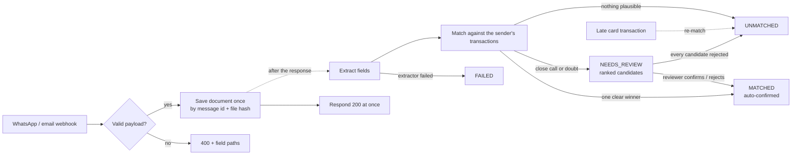
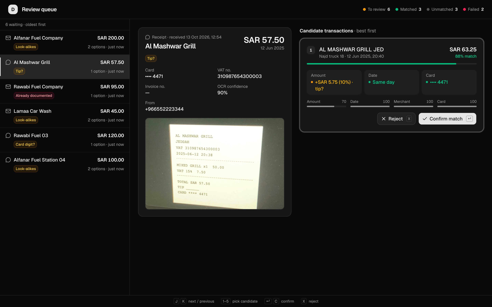
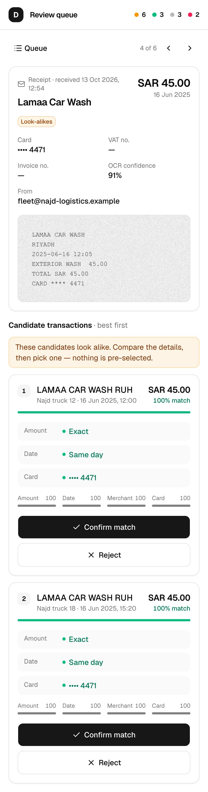

# Darb — Receipt & Invoice Matching

Drivers send receipt photos over **WhatsApp**; suppliers and fleet managers email **tax invoices**. This service
receives both through webhooks, extracts their data (a fixture-backed mock by default, or any vision LLM), **matches
each document to a card transaction with an explainable confidence score**, auto-attaches only what it is sure about,
and routes the grey zone to a **review queue** with reasons.

| Read next                                          | For                                                       |
| -------------------------------------------------- | --------------------------------------------------------- |
| [`IMPLEMENTATION.md`](IMPLEMENTATION.md)           | Scoring design, thresholds, every decision and trade-off  |
| [`docs/ARCHITECTURE.md`](docs/ARCHITECTURE.md)     | Layers, folder map, one diagram per flow, design patterns |
| [`docs/SCENARIOS.md`](docs/SCENARIOS.md)           | Every scenario: its data, fixture and expected outcome    |
| [`docs/TEST-INVENTORY.md`](docs/TEST-INVENTORY.md) | Every business rule and the test that proves it           |

## Contents

1. [How it works](#how-it-works)
2. [Features and how to use them](#features-and-how-to-use-them)
3. [Setup](#setup)
4. [Quick tests (seconds, no app needed)](#quick-tests-seconds-no-app-needed)
5. [Real tests (against the running app)](#real-tests-against-the-running-app)
6. [Command reference](#command-reference)
7. [Configuration](#configuration)
8. [Where to change things](#where-to-change-things)
9. [Project layout](#project-layout)

**Stack:** Next.js 15 (App Router, Route Handlers) · TypeScript 5 (strict) · Prisma 6 + SQLite · Zod 3 ·
next-safe-action 8 · Jest 29 · pino (async logging with rotation)

---

## How it works



1. **Receive.** A webhook is validated with Zod; a bad payload gets `400` with the offending field paths. The
   document is saved once: a redelivered message id or a re-sent identical file is reported as a duplicate, never a
   second document.
2. **Respond fast.** The webhook answers right after saving. Extraction and matching run after the response, so a
   slow or failing extractor can never cause a `500` or lose a document.
3. **Extract.** The extractor turns the file into fields: total, date, merchant, card last 4, VAT number. The mock
   returns committed fixture results keyed by the file's hash; `EXTRACTOR=llm` sends the file to a vision model.
4. **Scope.** Only transactions the sender may match are considered: a driver's phone → that driver's cards; an email
   → the client named by the `receipts+<client>@` alias or the registered sender address. Unknown senders match nothing.
5. **Match.** A pure function filters out impossible candidates (other client, other currency, outside the date
   window), scores the rest on amount, date, merchant name, card last 4 and scope, then applies decision gates:
   - **Auto-match** only one clear winner: high score, exact amount, strong identity signal, clear margin over the
     runner-up, confident OCR, and a transaction that has no confirmed document yet.
   - **Review** close calls, tips, possible card misreads and possible duplicate receipts — with reason codes.
   - **Unmatched** when nothing is plausible.
6. **Decide.** A reviewer confirms or rejects candidates at `/review`. The database itself guarantees at most one
   confirmed document per transaction and per document, so double clicks and races are safe.
7. **Catch up.** When a card transaction arrives late (`POST /api/transactions`), waiting `UNMATCHED` documents are
   matched again.

Every decision is stored with its per-signal breakdown and reasons, so "why was this matched?" always has an answer.
Diagrams for each flow: [`docs/ARCHITECTURE.md` §5](docs/ARCHITECTURE.md#5-flows).

---

## Features and how to use them

| Feature                                 | How to use it                                                                                                  | Details                                                                       |
| --------------------------------------- | -------------------------------------------------------------------------------------------------------------- | ----------------------------------------------------------------------------- |
| Email webhook                           | `POST /api/webhooks/email` with an inbound-parse payload                                                       | [IMPLEMENTATION §5](IMPLEMENTATION.md#5-ingestion-and-idempotency)            |
| WhatsApp webhook                        | `POST /api/webhooks/whatsapp` with a Meta Cloud API payload                                                    | [IMPLEMENTATION §5](IMPLEMENTATION.md#5-ingestion-and-idempotency)            |
| Idempotency                             | Send the same payload twice → `200` with `"result": "duplicate"`; no second document                           | [§5.1](IMPLEMENTATION.md#51-idempotency-keys)                                 |
| Explainable matching                    | `npm run db:report` shows status, reasons and every candidate's score                                          | [§3](IMPLEMENTATION.md#3-matching-engine)                                     |
| Review queue (bonus B1)                 | Open http://localhost:3000/review — keyboard driven, works on phones                                           | [Review queue](#review-queue)                                                 |
| Confirm / reject server actions         | `confirmMatch({ matchId })` / `rejectMatch({ matchId })` from [`lib/actions/review.ts`](lib/actions/review.ts) | [§7](IMPLEMENTATION.md#7-review-actions)                                      |
| Late transactions re-match (bonus B2)   | `POST /api/transactions` with a card-feed entry                                                                | [Try a late transaction](#4-a-late-transaction-re-matches-a-waiting-document) |
| Multi-transaction invoices (bonus B3)   | Design sketch only                                                                                             | [§12](IMPLEMENTATION.md#12-multi-transaction-invoices-design-sketch)          |
| Real extraction with any LLM (bonus B4) | Set `EXTRACTOR=llm` + `LLM_BASE_URL`, `LLM_MODEL`, `LLM_API_KEY`                                               | [Use a real model](#6-use-a-real-ai-model-instead-of-the-mock)                |
| Webhook signatures (bonus B5)           | Set `WHATSAPP_APP_SECRET`, `EMAIL_WEBHOOK_SECRET`, `TRANSACTIONS_WEBHOOK_SECRET`                               | [Signed webhooks](#5-signed-webhooks)                                         |
| Meta subscription handshake (bonus B5)  | Set `WHATSAPP_VERIFY_TOKEN`; Meta's `GET` is answered with the challenge                                       | [§5.6](IMPLEMENTATION.md#56-webhook-authentication-bonus-b5)                  |
| Original file preview                   | `GET /api/documents/<id>/file` (used by the review page)                                                       | —                                                                             |
| Structured, privacy-safe logs           | Logs go to the console and to rotated, gzipped files under `logs/`; phones and emails are masked               | [ARCHITECTURE §7](docs/ARCHITECTURE.md#7-logging)                             |

### Review queue

Documents the matcher was unsure about, decided one by one. Each candidate is compared side by side with the document
("+SAR 5.75 (10%) · tip?", "Receipt 4477 vs 4471 · misread?"), reason badges say what to check, and after a decision
the next document opens automatically. Moving between documents is instant: the next and previous ones are preloaded.

| Key            | Action                       |
| -------------- | ---------------------------- |
| `J` / `K`      | Next / previous document     |
| `1`–`5`        | Pick a candidate             |
| `Enter` or `C` | Confirm the picked candidate |
| `X`            | Reject the picked candidate  |

For look-alike candidates nothing is pre-selected, so a reflex `Enter` can never confirm a coin flip. The layout adapts
from two panes on desktop to list → detail on phones, and follows the system light/dark preference. Authentication is
out of scope: decisions are recorded as `reviewer:demo`.

 

---

## Setup

Requires **Node.js 20.6+** and npm. No API keys, Docker or external services are needed.

```bash
git clone https://github.com/gitAbid/darb-takehome.git && cd darb-takehome
npm install                 # installs dependencies and generates the Prisma client
cp .env.example .env        # default config: SQLite file, mock extractor, unsigned webhooks
npm run db:setup            # creates prisma/dev.db from the migrations and loads the seed data
npm run dev                 # http://localhost:3000 (redirects to /review)
```

What the seed loads: 2 clients, their registered sender emails and `receipts+<slug>@` aliases, 4 drivers, 5 cards
(two of them share a last 4 on purpose), 15 card transactions from June 2025, and one already-confirmed receipt. Each
row exists for a scenario in [`docs/SCENARIOS.md`](docs/SCENARIOS.md).

> On npm 11, install scripts are opt-in; `package.json#allowScripts` already approves the Prisma packages. If the
> Prisma client is missing, run `npx prisma generate`.

**Start over** with an empty, freshly seeded database: `npm run db:reset`. It deletes all data in `dev.db`.

**Production build:** `npm run build && npm start`. In production, logs go to stdout only.

---

## Quick tests (seconds, no app needed)

The whole suite runs in about 5 seconds on a laptop. Each test file gets its own migrated SQLite copy, so tests never touch
`dev.db` and need no running server. Tests always use the mock extractor, whatever `.env` says.

```bash
npm test                          # everything: 214 tests (1 opt-in live test is skipped)
npx jest __tests__/unit           # business logic only: matcher, signals, adapters, parsers
npx jest matcher                  # any file name fragment works, e.g. matcher, review, webhooks
npx jest -t "tip"                 # tests whose name matches
npm run test:coverage             # with coverage; fails below 90 % on any metric (currently ~99 %)
```

| Layer                   | What it proves                                                                          |
| ----------------------- | --------------------------------------------------------------------------------------- |
| `__tests__/unit`        | Matcher filters, signals and decision gates; adapters; sender resolution; LLM parsing   |
| `__tests__/integration` | Database-enforced rules, repositories, seed, fixture consistency, logging, storage, PDF |
| `__tests__/e2e`         | Real webhook handlers → pipeline → database for every scenario; review actions; B2, B5  |

Before pushing, run the same checks CI would:

```bash
npm run typecheck && npm run lint && npm run format:check && npm run test:coverage && npm run build
```

---

## Real tests (against the running app)

These exercise the real HTTP server, database and UI. Start the app first (`npm run dev`), then use a second terminal.

### 1. Fire every sample webhook

```bash
npm run demo:webhooks       # posts all scenario payloads (S01–S13), edge cases and a late transaction
npm run db:report           # what the pipeline decided: status, reasons, ranked candidates with scores
```

Expected outcomes, for example:

| Payload                         | Response                             | Document after processing                                                    |
| ------------------------------- | ------------------------------------ | ---------------------------------------------------------------------------- |
| S01 exact match                 | `200` created                        | `MATCHED` — T01 auto-confirmed (1.00), T03 kept as rejected runner-up (0.88) |
| S01 again (redelivery)          | `200` duplicate (`externalId`)       | unchanged — no second document                                               |
| S04 same photo, new message     | `200` duplicate (`contentHash`)      | unchanged                                                                    |
| S02 same chain, amount and day  | `200` created                        | `NEEDS_REVIEW` — `NEAR_TIE`                                                  |
| S03 restaurant tip              | `200` created                        | `NEEDS_REVIEW` — `AMOUNT_TIP_TOLERANCE`                                      |
| S10 extractor fails             | `200` created                        | `FAILED` — `EXTRACTION_ERROR` (the webhook still succeeded)                  |
| S11 the brief's example payload | `200` created                        | `UNMATCHED` — `UNKNOWN_SENDER` (supplier sender, no client alias)            |
| I01 malformed email             | `400` with the offending field paths | none                                                                         |

The full list is in [`docs/SCENARIOS.md`](docs/SCENARIOS.md). Browse the raw data with `npx prisma studio`.

### 2. Send one request at a time

Open [`requests.http`](requests.http) in VS Code (_REST Client_ extension) or a JetBrains IDE and click "Send" above
each request; every request is labelled with its expected outcome. Or use curl:

```bash
curl -X POST http://localhost:3000/api/webhooks/whatsapp \
  -H 'content-type: application/json' --data-binary @fixtures/scenarios/01-exact-match/payload.json
```

### 3. Decide in the review queue

Open http://localhost:3000/review after firing the webhooks. Confirm or reject candidates with the mouse or keys, then
run `npm run db:report` again: a confirmed document becomes `MATCHED`, and a document whose last candidate is rejected
becomes `UNMATCHED`.

### 4. A late transaction re-matches a waiting document

A receipt can arrive before its card transaction. Send S05 first (it ends `UNMATCHED`), then post the transaction:

```bash
curl -X POST http://localhost:3000/api/transactions -H 'content-type: application/json' -d '{
  "externalRef": "feed-T16", "clientId": 1, "cardId": 3, "driverPhone": "+966554445566",
  "merchantName": "SAHARA AUTO SVC RUH", "mcc": "7538", "amount": 34000, "transactionAt": "2025-06-15T08:00:00Z"
}'   # → 201; S05 becomes MATCHED (npm run db:report). Sending it again → 200 duplicate.
```

`npm run demo:webhooks` already does this as its last step.

### 5. Signed webhooks

Add secrets to `.env` and restart the app. Unsigned or wrongly signed requests then get `401`:

```bash
WHATSAPP_APP_SECRET=dev-whatsapp-secret
EMAIL_WEBHOOK_SECRET=dev-email-secret
TRANSACTIONS_WEBHOOK_SECRET=dev-transactions-secret
WHATSAPP_VERIFY_TOKEN=verify-me
```

Export the same values in the terminal before `npm run demo:webhooks` and every request is signed to match. To sign a
single request by hand:

```bash
BODY=fixtures/scenarios/01-exact-match/payload.json
SIG=$(openssl dgst -sha256 -hmac "$WHATSAPP_APP_SECRET" -hex < "$BODY" | sed 's/^.* //')
curl -X POST http://localhost:3000/api/webhooks/whatsapp -H 'content-type: application/json' \
  -H "x-hub-signature-256: sha256=$SIG" --data-binary @"$BODY"
```

Meta's subscription check: `curl 'http://localhost:3000/api/webhooks/whatsapp?hub.mode=subscribe&hub.verify_token=verify-me&hub.challenge=42'`
→ `42`; a wrong token → `403`. Email and transactions use the `x-signature-256` header.

### 6. Use a real AI model instead of the mock

Set these in `.env` and restart. Any OpenAI-compatible provider works; only the URL, model and key change:

```bash
EXTRACTOR=llm
LLM_BASE_URL=https://api.openai.com/v1        # Anthropic https://api.anthropic.com/v1/ · Gemini https://generativelanguage.googleapis.com/v1beta/openai/ · Ollama http://localhost:11434/v1
LLM_MODEL=gpt-6-luna                          # or claude-sonnet-5-5, a Gemini model, a local vision model
LLM_API_KEY=sk-...                            # omit for keyless local servers
LLM_STRUCTURED_OUTPUT=true                    # OpenAI and Gemini: strict JSON replies; leave false for Anthropic
LLM_TIMEOUT_MS=60000                          # reasoning models can take longer than the 30 s default
```

Check the provider first with the opt-in live test (reads a real phone photo and expects 150.00 SAR, card 4471 and
2025-06-10):

```bash
set -a; . ./.env; set +a; LLM_LIVE_TEST=1 npx jest extraction-llm-io
```

Then `npm run demo:webhooks` sends the real documents to the model; each takes a few seconds. Expect two outcomes to
differ from the documented ones, because the mock fakes two failures on purpose: **S09** (the mock pretends card 4471
was misread as 4477) becomes `MATCHED`, and **S10** (the mock pretends the extractor crashed) is read normally and ends
`UNMATCHED`. PDFs are sent as their text layer, so scanned PDFs without text end `FAILED`. Documents are sent to the
provider you configure — mind data-protection rules before using real customer documents. Set `EXTRACTOR=mock` (or
remove the line) to go back. Design: [IMPLEMENTATION.md §5.7](IMPLEMENTATION.md#57-real-extraction-with-any-llm-bonus-b4).

---

## Command reference

| Command                                         | What it does                                                                                         | When to use it                                    |
| ----------------------------------------------- | ---------------------------------------------------------------------------------------------------- | ------------------------------------------------- |
| **Run**                                         |                                                                                                      |                                                   |
| `npm run dev`                                   | Starts the dev server on http://localhost:3000 with hot reload                                       | Day-to-day development                            |
| `npm run build`                                 | Production build; also type-checks and lints                                                         | Before shipping, or to try production locally     |
| `npm start`                                     | Serves the production build                                                                          | After `npm run build`                             |
| **Database**                                    |                                                                                                      |                                                   |
| `npm run db:setup`                              | Applies the migrations and loads the seed data (non-destructive)                                     | First setup                                       |
| `npm run db:reset`                              | **Deletes all data**, recreates the database and re-seeds it                                         | Start over after experimenting                    |
| `npm run db:migrate`                            | Creates and applies a new migration after you edit `prisma/schema.prisma`                            | Schema changes                                    |
| `npm run db:seed`                               | Loads the seed data only                                                                             | Rarely; `db:setup` already seeds                  |
| `npm run db:report`                             | Prints every document with its status, reasons and ranked candidates                                 | After firing webhooks or reviewing                |
| `npx prisma studio`                             | Opens a browser UI over the database tables                                                          | Inspecting raw rows                               |
| **Demo**                                        |                                                                                                      |                                                   |
| `npm run demo:webhooks [base-url]`              | Posts every sample payload and the late transaction; signs them when secrets are exported            | With the app running                              |
| **Tests and quality**                           |                                                                                                      |                                                   |
| `npm test`                                      | Runs all tests (each file on its own SQLite copy)                                                    | Constantly                                        |
| `npm run test:coverage`                         | Tests with coverage; fails below 90 % on any metric                                                  | Before pushing                                    |
| `npm run test:mix`                              | Counts unit / integration / e2e tests against the 50 / 30 / 20 target                                | When adding tests                                 |
| `npm run typecheck`                             | TypeScript strict check without emitting files                                                       | Before pushing                                    |
| `npm run lint`                                  | ESLint (Next rules, no `any`, member ordering)                                                       | Before pushing                                    |
| `npm run format` / `npm run format:check`       | Formats with Prettier (120 columns) / checks formatting only                                         | Before pushing                                    |
| **Fixtures**                                    |                                                                                                      |                                                   |
| `npm run fixtures:render [-- --force]`          | Renders missing scenario documents and printable receipts; `--force` rewrites existing ones          | Adding a scenario (`--force` changes file hashes) |
| `npm run fixtures:payloads`                     | Rebuilds every webhook payload and the media map from the committed documents (no diff if unchanged) | After changing a fixture document                 |
| `npm run fixtures:sanitize -- <photo> <folder>` | Strips EXIF/GPS from a phone photo, resizes it and installs it as that scenario's document           | Replacing a fixture photo                         |

`npm install` also runs `prisma generate` automatically (the `postinstall` script).

### Replacing a fixture photo

Four scenarios (01, 03, 09, 12) use real phone photos of the printable receipts in `fixtures/print/`. To replace one,
print and photograph the receipt, then run `npm run fixtures:sanitize -- <photo.jpg> <folder>` followed by
`npm run fixtures:payloads`. Keep raw photos in `fixtures/_incoming/` (gitignored): they can carry GPS data.

---

## Configuration

Everything is optional except `DATABASE_URL`; [`.env.example`](.env.example) lists all variables with their defaults.
Configuration is validated at startup, and the app refuses to start with a message naming the bad variable.

| Area               | Variable                                                                | Default                      | Purpose                                                       |
| ------------------ | ----------------------------------------------------------------------- | ---------------------------- | ------------------------------------------------------------- |
| Database           | `DATABASE_URL`                                                          | `file:./dev.db`              | SQLite file, relative to `prisma/`                            |
| Files              | `FIXTURES_DIR`                                                          | `fixtures`                   | Mock extraction results and WhatsApp media fixtures           |
|                    | `BLOB_DIR`                                                              | `.storage`                   | Where received document files are stored, by content hash     |
|                    | `MEDIA_FETCH_TIMEOUT_MS`                                                | `3000`                       | WhatsApp media download timeout                               |
| Logging            | `LOG_SINK`                                                              | `pino`                       | `pino` · `console` · `test`                                   |
|                    | `LOG_LEVEL`                                                             | `info`                       | `debug` adds fields read, scored candidates, LLM timings      |
|                    | `LOG_FILE_ENABLED`                                                      | `true` (dev), `false` (prod) | Rotated, gzipped files under `LOG_DIR`                        |
|                    | `LOG_DIR` · `LOG_ROTATE_SIZE` · `LOG_ROTATE_INTERVAL` · `LOG_MAX_FILES` | `logs` · `10M` · `1d` · `14` | File rotation                                                 |
| Webhook signatures | `WHATSAPP_APP_SECRET`                                                   | unset (unsigned allowed)     | Verifies `X-Hub-Signature-256` on the WhatsApp webhook        |
|                    | `EMAIL_WEBHOOK_SECRET` · `TRANSACTIONS_WEBHOOK_SECRET`                  | unset (unsigned allowed)     | Verifies `X-Signature-256` on the email / transactions routes |
|                    | `WHATSAPP_VERIFY_TOKEN`                                                 | unset (handshake → 403)      | Answers Meta's `GET` subscription handshake                   |
| Extraction         | `EXTRACTOR`                                                             | `mock`                       | `mock` (fixtures, no keys) · `llm` (real model)               |
|                    | `LLM_BASE_URL` · `LLM_MODEL`                                            | — (required for `llm`)       | Provider endpoint and model                                   |
|                    | `LLM_API_KEY`                                                           | —                            | Omit for keyless local servers                                |
|                    | `LLM_TIMEOUT_MS`                                                        | `30000`                      | Per-request timeout                                           |
|                    | `LLM_TEMPERATURE`                                                       | unset                        | Provider default; Claude 4.7+ rejects values below 1          |
|                    | `LLM_STRUCTURED_OUTPUT`                                                 | `false`                      | Strict JSON replies where supported (OpenAI, Gemini)          |

An unset webhook secret logs a `webhook.signature_disabled` warning for that endpoint, so local runs need no setup but
a misconfigured deployment is visible in the logs.

---

## Where to change things

| I want to…                             | Look at                                                                                                                                          |
| -------------------------------------- | ------------------------------------------------------------------------------------------------------------------------------------------------ |
| Tune a weight or threshold             | [`lib/services/matching/matching-config.ts`](lib/services/matching/matching-config.ts) (one typed object, values explained in IMPLEMENTATION §3) |
| Add a matching signal                  | A new `SignalScorer` in `lib/services/matching/signals/`, registered in `default-matcher.ts`                                                     |
| Add a hard filter                      | A new `CandidateFilter` in `lib/services/matching/filters/`                                                                                      |
| Change how merchant names are compared | `lib/services/matching/text/`                                                                                                                    |
| Add a channel (e.g. SMS)               | A Zod schema + adapter in `lib/webhooks/<channel>/`, a route in `app/api/webhooks/<channel>/`                                                    |
| Plug in another extractor              | Implement `DocumentExtractor` ([`lib/extraction/types.ts`](lib/extraction/types.ts)) and select it in `lib/extraction/create-extractor.ts`       |
| Ask the LLM for a new field            | [`lib/extraction/llm/llm-extraction.schema.ts`](lib/extraction/llm/llm-extraction.schema.ts); the prompt picks it up automatically               |
| Swap a concrete implementation         | The composition root: [`lib/container.ts`](lib/container.ts) and its builders in `lib/composition/`                                              |
| Add a scenario                         | `docs/SCENARIOS.md` row → seed data in `prisma/seed-data/` → fixture folder → `npm run fixtures:payloads` (a consistency test checks they agree) |

---

## Project layout

```text
app/api/webhooks/{email,whatsapp}/route.ts   HTTP only → lib/container.ts
app/api/transactions/route.ts                card-feed entry point (late transactions, bonus B2)
app/review/page.tsx                          review queue UI (bonus B1)
lib/services/document-ingestion.ts           webhook → document pipeline (facade)
lib/services/transaction-matcher.ts          matching engine (pure)
lib/services/{ingestion,matching,review}/    the focused modules behind those facades
lib/webhooks/                                Zod payload schemas, channel adapters, HMAC verification
lib/extraction/  lib/media/  lib/storage/    swappable extractor (mock / LLM), media store, blob store
lib/repositories/                            interfaces + Prisma implementations
lib/actions/review.ts                        confirm / reject server actions
lib/container.ts                             composition root: the one place concretes are wired
prisma/                                      schema, migrations (with CHECK constraints), seed
fixtures/                                    scenario documents, extraction results, webhook payloads
scripts/                                     fixture generators, demo scripts, test-mix report
__tests__/{unit,integration,e2e}/            tests by layer
```

The full map and the reasoning behind it are in [`docs/ARCHITECTURE.md`](docs/ARCHITECTURE.md).
