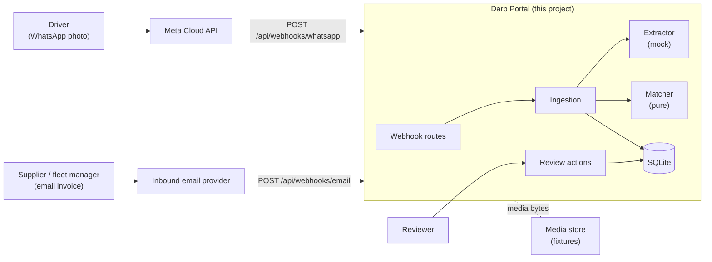
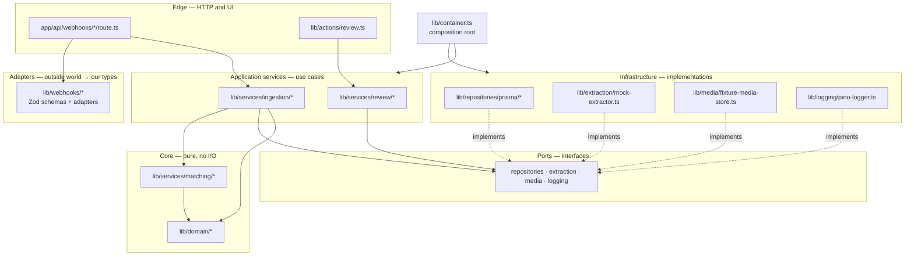
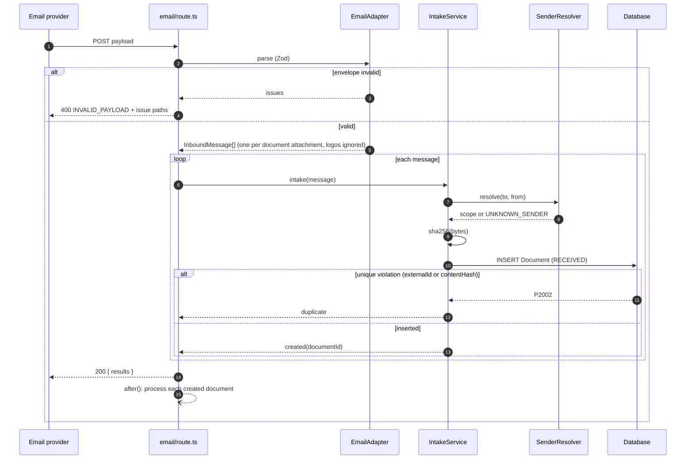
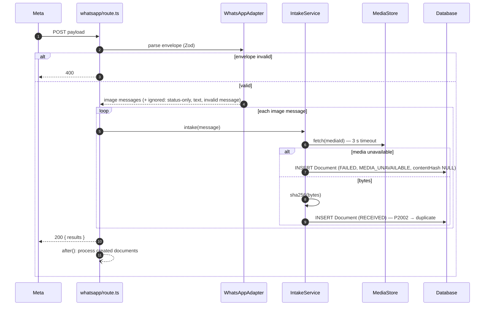
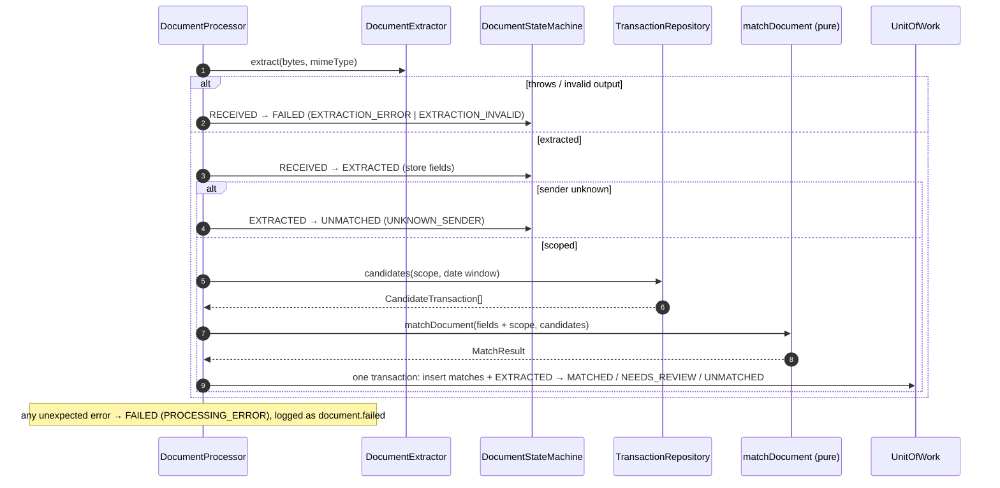
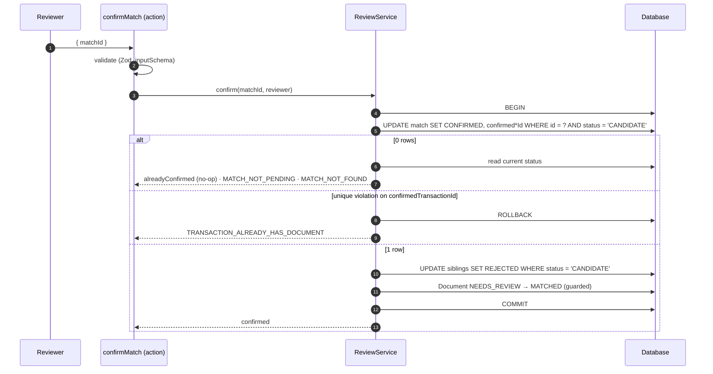
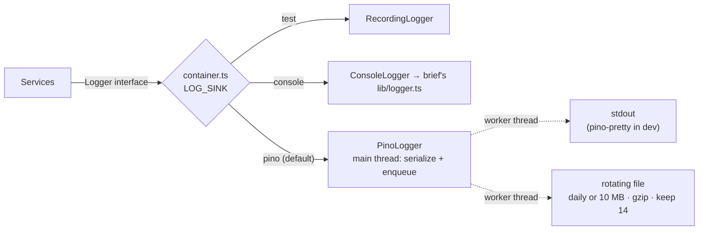

# Architecture

How the code is organized, which parts can be swapped, and how a document flows through the system. Design decisions
and the matching math are in [`IMPLEMENTATION.md`](../IMPLEMENTATION.md); test data is in [`SCENARIOS.md`](SCENARIOS.md).

## Contents

1. [System context](#1-system-context)
2. [Layers and the dependency rule](#2-layers-and-the-dependency-rule)
3. [Folder map](#3-folder-map)
4. [Interfaces, patterns and the composition root](#4-interfaces-patterns-and-the-composition-root)
5. [Flows](#5-flows)
6. [Error handling](#6-error-handling)
7. [Logging](#7-logging)
8. [Configuration](#8-configuration)
9. [Testing strategy](#9-testing-strategy)
10. [Code conventions](#10-code-conventions)

---

## 1. System context



External systems (Meta, the email provider, the OCR provider, media storage) are **mocked behind interfaces**; the
engineering is in the pipeline and the matcher.

---

## 2. Layers and the dependency rule



**The rule:** arrows point inwards. Services know only **interfaces** (ports), never Prisma, the file system or pino.
The matcher and domain know nothing but plain data. Only `lib/container.ts` knows which concrete class implements
which interface. This is what makes every external dependency replaceable with a one-line change.

---

## 3. Folder map

Paths the brief prescribes are kept exactly; where one would grow too large it becomes a **thin facade** over a
focused subfolder.

```text
app/
  api/webhooks/email/route.ts         ◀ brief · HTTP only: adapt → intake → respond → after(process)
  api/webhooks/whatsapp/route.ts      ◀ brief · same, WhatsApp adapter
  api/transactions/route.ts           card feed → re-matching (bonus B2)
  review/page.tsx · loading.tsx       ◀ brief · review queue (bonus B1), server-rendered
  api/documents/[id]/file/route.ts    original document file for reviewers
lib/
  prisma.ts · utils.ts · logger.ts    ◀ brief boilerplate, unchanged
  container.ts                        composition root: wires implementations to interfaces
  domain/                             pure types and helpers, no I/O
    riyadh-day · clock · statuses · reason-codes · content-hash · document-date · phone · with-timeout
  logging/
    logger.ts                         Logger interface
    console-logger.ts                 adapts the brief's lib/logger.ts
    pino-logger.ts                    default: async transports, rotation + gzip
    recording-logger.ts               for tests
    redact.ts · serialize-error.ts
    transports/rotating-file.mjs      worker-thread transport on rotating-file-stream
  config/app-config.ts                Zod-parsed environment (fail fast)
  storage/                            BlobStore interface · LocalFileBlobStore (keys = content hashes)
  webhooks/
    inbound-message.ts                channel-agnostic InboundMessage / AdaptedDelivery types
    attachment-policy.ts · payload-issues.ts
    email/email-payload.schema.ts · email-adapter.ts
    whatsapp/whatsapp-payload.schema.ts · whatsapp-adapter.ts
    http/webhook-handler.ts           JSON → service → 200 / 400 / 500
    http/transaction-handler.ts       card feed → 201 / 200 duplicate / 400 / 500
    http/read-json.ts                 shared JSON body parsing
    http/next-after-scheduler.ts      BackgroundScheduler on Next.js after()
  extraction/
    types.ts                          ◀ brief interface, verbatim
    mock-extractor.ts                 ◀ brief · hash → fixture result
    fixture-registry.ts               hashes fixture files at load
    fixture-files.ts                  the only file-system reader for fixtures
    extraction-result.schema.ts       Zod: extractor output is untrusted
    extraction-errors.ts              ExtractionFailedError · InvalidExtractionError
  media/
    media-store.ts                    MediaStore interface
    fixture-media-store.ts            media id → fixtures file
    media-errors.ts                   MediaNotFoundError
  services/
    document-ingestion.ts             ◀ brief · facade: intake + process
    transaction-matcher.ts            ◀ brief · facade: matchDocument + public types
    ingestion/
      intake-service.ts               media fetch (timeout) → blob → insert-first dedupe
      sender-resolver.ts · sender-identity.ts   alias → registered sender → phone → scope
      document-processor.ts           extract → match → persist (post-response)
      document-state-machine.ts       allowed transitions + guarded updates
      match-stage.ts                  candidates → match → persist (shared with re-matching)
      match-persistence.ts            MatchResult → rows; race demotion
      match-logging.ts                one match.decided event per decision
      background-scheduler.ts         interface for post-response work
    matching/
      types.ts · matching-config.ts
      matcher.ts                      createMatcher(config) → matchDocument
      filters/                        candidate-filter.ts + scope · currency · date-window · amount · card
      signals/                        signal-scorer.ts + amount · date · merchant · card · scope
      scoring.ts · ranking.ts · decision-policy.ts
      text/                           merchant-normalizer.ts · string-similarity.ts · token-dice-similarity.ts
                                      · jaro-winkler.ts · merchant-vocabulary.ts
    review/
      review-service.ts · review-outcome.ts · reviewer.ts · document-file-service.ts
    transactions/                     bonus B2: payload schema · TransactionIngestionService · RematchService
  repositories/                       interfaces
    unit-of-work.ts · document-repository.ts · transaction-repository.ts
    · match-repository.ts · sender-directory.ts · review-queue-reader.ts (read model)
    prisma/                           Prisma implementations + map-prisma-error.ts
  actions/
    safe-action-client.ts             ◀ brief boilerplate
    review.ts                         ◀ brief · confirmMatch / rejectMatch (thin)
components/review/                    queue list, document panel, candidate board (client), badges
lib/review-ui/                        pure presentation logic: comparisons, reason copy, view models, navigation
prisma/
  schema.prisma · migrations/         ◀ brief
  seed.ts                             ◀ brief · loader only
  seed-data/                          clients · cards · transactions · documents (from SCENARIOS.md)
fixtures/                             ◀ brief
  scenarios/<id>-<slug>/              document.* · extraction.json · payload.json
  payloads/ingestion/                 malformed / status-only / text / unknown-media payloads
  print/                              80 mm receipts to print and photograph
  assets/logo.png · media-map.json · ATTRIBUTION.md
scripts/
  fixtures/                           render-receipts.ts · sanitize-photo.ts · build-sample-payloads.ts (CLIs)
                                      + small modules: receipt-svg, render-image, render-pdf, payload-builders, …
  fire-webhooks.sh
types/                                ◀ brief · webhook payload types inferred from the Zod schemas
__tests__/                            ◀ brief (Jest only runs **/__tests__/**/*.test.ts)
  unit/ · integration/ · routes/ · helpers/
  setup/                              migrate a template DB once; copy it per test file
docs/                                 ARCHITECTURE.md · SCENARIOS.md
```

---

## 4. Interfaces, patterns and the composition root

### 4.1 Replaceable parts

| Interface               | Responsibility                                    | Default implementation        | Example replacement                  |
| ----------------------- | ------------------------------------------------- | ----------------------------- | ------------------------------------ |
| `DocumentExtractor`     | File bytes → `ExtractedDocument` (brief)          | `MockExtractor`               | LLM vision / Textract / Azure DI     |
| `MediaStore`            | WhatsApp media id → bytes                         | `FixtureMediaStore`           | Meta Graph API client                |
| `DocumentRepository`    | Documents: insert, load, update with status guard | `PrismaDocumentRepository`    | Postgres / other ORM                 |
| `TransactionRepository` | In-scope candidates within a date window          | `PrismaTransactionRepository` | Card-processor API                   |
| `MatchRepository`       | Persist candidates, confirm/reject                | `PrismaMatchRepository`       | —                                    |
| `SenderDirectory`       | Alias / email / phone → scope                     | `PrismaSenderDirectory`       | Client-management service            |
| `UnitOfWork`            | Run several repository calls atomically           | `PrismaUnitOfWork`            | —                                    |
| `CandidateFilter`       | One hard filter                                   | 5 filters                     | Add a filter without touching others |
| `SignalScorer`          | One signal, 0..1 or "not measurable"              | 5 scorers                     | Add VAT-number signal                |
| `DecisionPolicy`        | Ranked candidates → outcome + reasons             | `GatedDecisionPolicy`         | Calibrated-probability policy        |
| `StringSimilarity`      | Two token lists → 0..1                            | `TokenDiceSimilarity`         | Trigram, embeddings                  |
| `Logger`                | Structured events                                 | `PinoLogger`                  | `ConsoleLogger`, Datadog             |
| `Clock`                 | Current time                                      | `SystemClock`                 | `FixedClock` in tests                |

### 4.2 Design patterns used, and why

| Pattern                        | Where                                                 | Why it beats the obvious alternative                                                                   |
| ------------------------------ | ----------------------------------------------------- | ------------------------------------------------------------------------------------------------------ |
| **Strategy**                   | `SignalScorer`, `CandidateFilter`, `StringSimilarity` | New signal or filter = new file; the scorer never changes (open/closed). A `switch` would grow forever |
| **Adapter**                    | Email/WhatsApp → `InboundMessage`; `ConsoleLogger`    | One pipeline for every channel; a new channel is one adapter                                           |
| **Repository + Unit of Work**  | `lib/repositories/*`                                  | Services are testable and ORM-agnostic; multi-table writes stay atomic                                 |
| **Facade**                     | `document-ingestion.ts`, `transaction-matcher.ts`     | Honours the brief's file paths without bloating them                                                   |
| **State machine**              | `DocumentStateMachine`                                | Illegal status changes are impossible by construction, not by discipline                               |
| **Factory / composition root** | `createMatcher(config)`, `container.ts`               | Swapping an implementation is a one-line change in one file                                            |
| **Chain (pipeline)**           | Filters → scorers → policy                            | Each stage is small, ordered and independently testable                                                |

Patterns deliberately **not** used: a DI container library (one hand-written `container.ts` is clearer at this size),
event bus / CQRS (one process, one database — would add indirection without benefit).

### 4.3 Composition root

```ts
// lib/container.ts (shape)
export function createContainer(env: AppEnv): Container {
  const logger = createLogger(env.logging);
  const unitOfWork = new PrismaUnitOfWork(prisma);
  const extractor = new MockExtractor(FixtureRegistry.load(env.fixturesDir)); // swap here
  const mediaStore = new FixtureMediaStore(env.fixturesDir); // swap here
  const matchDocument = createMatcher(defaultMatchingConfig);
  // ...services receive only interfaces
}
```

---

## 5. Flows

### 5.1 Email webhook — request path



### 5.2 WhatsApp webhook — request path

Differences from email: a delivery can carry several entries/messages; only `image` messages become documents; the
bytes come from the `MediaStore`.



### 5.3 Processing — after the response



### 5.4 Matching pipeline

See [`IMPLEMENTATION.md` § 3.2](../IMPLEMENTATION.md#32-pipeline).

### 5.5 Review — confirm



`rejectMatch` follows the same shape; after rejecting it counts remaining `CANDIDATE` siblings and moves the document
to `UNMATCHED` when none remain.

### 5.6 State machines and data model

See [`IMPLEMENTATION.md` § 6](../IMPLEMENTATION.md#6-data-model).

---

## 6. Error handling

| Kind                        | Representation                                                    | Example                                    |
| --------------------------- | ----------------------------------------------------------------- | ------------------------------------------ |
| **Expected outcome**        | Discriminated union returned by the service                       | `{ kind: 'duplicate', by: 'contentHash' }` |
| **Expected business error** | Typed `DomainError` with a stable `code`                          | `TRANSACTION_ALREADY_HAS_DOCUMENT`         |
| **Invalid input**           | Zod issues, mapped to 400 or a validation action result           | missing `attachments`                      |
| **Unexpected failure**      | Exception, caught at the boundary, logged, mapped to `FAILED`/500 | database down, extractor crash             |

Infrastructure errors are translated at the repository edge (`map-prisma-error.ts`: `P2002` → `UniqueViolation`
naming the column), so services never import Prisma types.

---

## 7. Logging



- **Async:** pino transports write from a worker thread, so disk or terminal I/O never delays a webhook response.
- **Rotation + compression:** `rotating-file-stream` (pino-roll cannot compress). Disabled with
  `LOG_FILE_ENABLED=false` on containers/serverless, where stdout is collected and rotated by the platform.
- **Events, not prose:** `webhook.received`, `webhook.rejected`, `webhook.message_ignored`, `document.created`,
  `document.duplicate`, `sender.unknown`, `extraction.completed`, `match.decided`, `document.failed`,
  `review.confirmed`, `review.rejected`, `review.conflict` — each with structured context.
- **Correlation:** each request gets a `correlationId`; a child logger carries it into the post-response processing,
  plus `documentId` once known.
- **Privacy (Saudi PDPL):** never log file bytes, raw OCR text or full payloads; phones and emails are masked
  (`+9665•••••567`, `f•••@najd-logistics.example`); pino `redact` paths are a second safety net.
- **The matcher never logs** (it is pure); the processor logs its result once as `match.decided`.
- **Logs are not the audit trail** — `decidedBy`, `decidedAt`, `signals`, `failureReason` in the database are.
- **Implementation notes:** pretty output is derived (`NODE_ENV !== 'production'`) rather than configured; the rotation
  options are built and tested in TypeScript (`rotating-file-options.ts`) and only forwarded by the `.mjs` worker,
  which cannot load TypeScript; redaction covers top-level fields (`contentBase64`, `rawText`, `phone`, `email`) as well
  as the `*.`-nested paths, because events log their context at the top level.

---

## 8. Configuration

| Variable                 | Default                                          | Purpose                                      |
| ------------------------ | ------------------------------------------------ | -------------------------------------------- |
| `DATABASE_URL`           | `file:./dev.db`                                  | SQLite database                              |
| `FIXTURES_DIR`           | `fixtures`                                       | Mock extractor registry and media store root |
| `MEDIA_FETCH_TIMEOUT_MS` | `3000`                                           | WhatsApp media fetch timeout at intake       |
| `LOG_SINK`               | `pino`                                           | `pino` · `console` · `test`                  |
| `LOG_LEVEL`              | `info`                                           |                                              |
| `LOG_FILE_ENABLED`       | `true` outside production, `false` in production | Disable on containers/serverless             |
| `LOG_DIR`                | `logs`                                           | Rotated files (gitignored)                   |
| `LOG_ROTATE_SIZE`        | `10M`                                            |                                              |
| `LOG_ROTATE_INTERVAL`    | `1d`                                             |                                              |
| `LOG_MAX_FILES`          | `14`                                             |                                              |

Environment is parsed once with Zod at startup (`AppEnv`); invalid configuration fails fast with a clear message.

---

## 9. Testing strategy

| Layer       | What                                                                                                    | How                                                                        |
| ----------- | ------------------------------------------------------------------------------------------------------- | -------------------------------------------------------------------------- |
| Unit        | Matcher (filters, signals, policy, ranking), text helpers, domain helpers, adapters, schemas, redaction | Pure functions, table-driven from `SCENARIOS.md`                           |
| Integration | Repositories, intake, processor, review service, schema constraints                                     | Real SQLite: a migrated template copied per test file (`__tests__/setup/`) |
| Route       | Both webhook `POST` handlers                                                                            | Call the exported handler with a `Request`; assert status + body + rows    |
| Consistency | Seed ⇄ fixtures ⇄ scenario matrix                                                                       | One test that fails on drift                                               |

Shape of the suite: **lean and rule-driven** — every business rule has at least one test and no rule is tested twice
at the same layer ([`TEST-INVENTORY.md`](TEST-INVENTORY.md) maps each rule to its test). Target mix by count is 50 %
unit / 30 % integration / 20 % end-to-end (`npm run test:mix`); scenario volume lives in one end-to-end table rather
than in many unit tests.

Rules:

- **Failure paths are first-class:** every service has tests for its error branches (invalid input, unique
  violations, missing media, extractor throwing, conflicting reviews), not only the happy path.
- **Invariants** for the matcher: scores stay in [0, 1]; input order never changes the result; a closer date never
  lowers a score; a contradicting card never raises one.
- **Coverage gate:** ≥ 90 % branches, functions, lines and statements (`npm run test:coverage`), enforced in
  `jest.config.ts`.

---

## 10. Code conventions

- TypeScript strict; no `any` (ESLint error); Zod at every trust boundary.
- Prettier, 120-character lines.
- **Small units:** one class or concern per file; functions short enough to read without scrolling.
- **Ordering inside a class:** fields/constants → constructor → methods (ESLint `member-ordering`).
  **Ordering inside a file:** constants → types/interfaces → functions/classes. Methods appear in **call order**
  (a caller sits above the methods it calls), so a file reads top-down like a story.
- Depend on interfaces; construct concrete classes only in `lib/container.ts` (and in tests).
